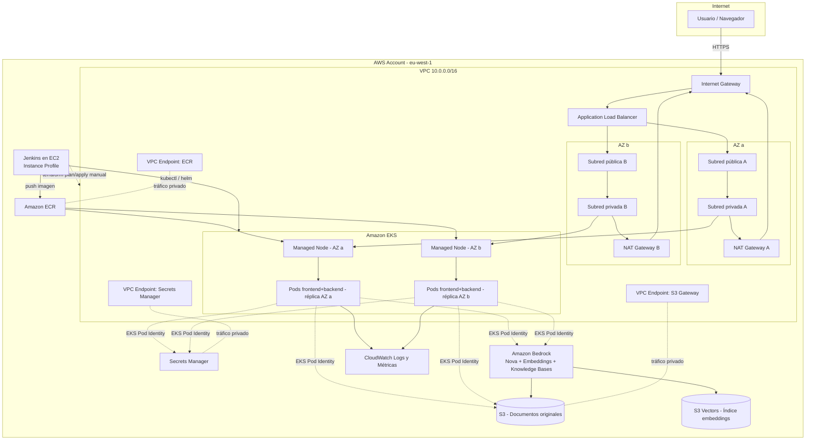
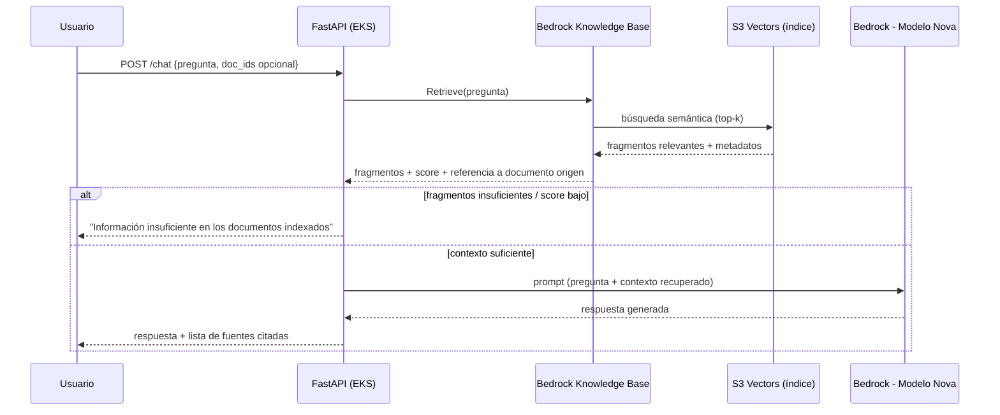
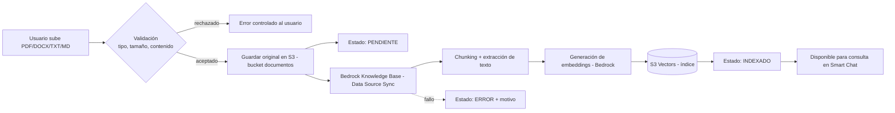
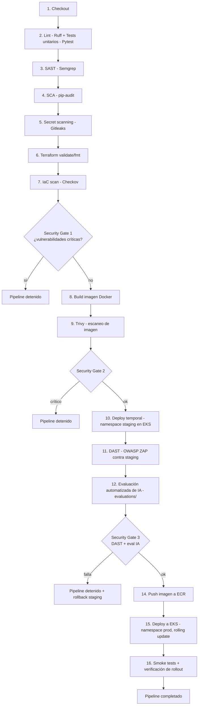
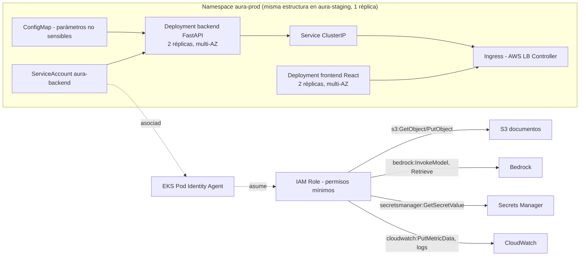
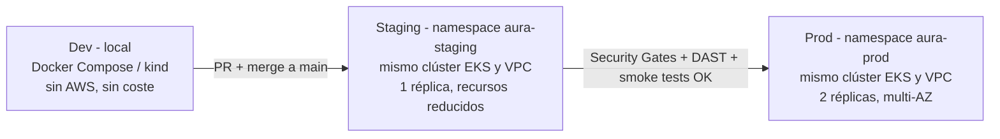

# AURA — AI Knowledge Engine

## Documento de Arquitectura Técnica (Fase 1 — Diseño)

**Estado:** Pendiente de aprobación para iniciar Fase 2.
**Región objetivo:** `eu-west-1` (Irlanda), salvo justificación técnica en contra.
**Audiencia:** documento de referencia del propio proyecto — guía todas las fases posteriores y sirve como pieza de portfolio.

---

## 1. Resumen ejecutivo

AURA es una plataforma de inteligencia documental (RAG) sobre AWS que permite subir documentos, indexarlos semánticamente y consultarlos mediante Amazon Bedrock. El proyecto se construye en 10 fases verificables, cada una con entregables probados antes de avanzar. Este documento cierra la Fase 1: valida la propuesta técnica original, corrige incompatibilidades, define la arquitectura definitiva, el MVP, el presupuesto estimado y el orden de implementación.

No se ha creado ningún recurso en AWS. No se ha ejecutado código. Este es un documento de diseño.

---

## 2. Observaciones sobre la propuesta técnica original

Antes de fijar la arquitectura definitiva, se identifican los siguientes puntos que requieren decisión o corrección:

### 2.1 Amazon S3 Vectors + Bedrock Knowledge Bases
Amazon S3 Vectors (almacenamiento vectorial nativo en S3) es una capacidad relativamente nueva y su integración como *vector store* de Bedrock Knowledge Bases debe verificarse en el momento de implementar:
- **Disponibilidad regional**: las capacidades nuevas de AWS suelen lanzarse primero en `us-east-1`. Debe confirmarse disponibilidad en `eu-west-1` antes de la Fase 6. Si no está disponible, la alternativa validada y estable es **OpenSearch Serverless** como vector store de la Knowledge Base (mayor coste fijo) o **Aurora PostgreSQL Serverless v2 con pgvector** (coste más predecible en entornos pequeños).
- **Decisión**: se mantiene S3 Vectors como opción preferente por coste (sin coste base cuando no hay tráfico, frente a OpenSearch Serverless que factura capacidad mínima reservada), con OpenSearch Serverless como plan B documentado. Se verificará disponibilidad real en `eu-west-1` al inicio de la Fase 6, antes de escribir Terraform.

### 2.2 LangChain + boto3 + Bedrock Knowledge Bases: solapamiento
La Knowledge Base de Bedrock ya expone `RetrieveAndGenerate` / `Retrieve` vía boto3 (`bedrock-agent-runtime`), cubriendo chunking, embeddings, recuperación y citación de fuentes de forma nativa. Introducir LangChain para re-implementar ese mismo flujo sería redundancia, no valor.
- **Decisión**: la ingestión y el RAG base (Smart Chat) usan **boto3 directo** contra Bedrock Knowledge Bases. LangChain se reserva para funcionalidades donde sí aporta algo que boto3 no da gratis: orquestación multi-documento en **Document Compare** y **Deep Research** (fases avanzadas), donde se necesita encadenar múltiples llamadas, comparar resultados y sintetizar. Esto respeta la restricción explícita de la propuesta ("LangChain cuando aporte valor real").

### 2.3 NAT Gateway multi-AZ: coste vs. disponibilidad — decisión cerrada: 2 NAT Gateways
Un NAT Gateway por AZ (2 en total) es la práctica recomendada para alta disponibilidad, pero duplica un coste fijo relativamente alto (~0,05 $/h cada uno + procesamiento de datos).
- **Decisión final**: **2 NAT Gateways** (uno por AZ), priorizando fidelidad a un entorno de producción real sobre el ahorro de ~30 €/mes que daría un único NAT. Se acepta el sobrecoste a cambio de eliminar el punto único de fallo de red saliente. Reflejado en el presupuesto de la §6.
- Adicionalmente, se añadirán **VPC Endpoints de Gateway** (S3) y, si el coste lo permite, **Interface Endpoints** (Secrets Manager, ECR, Bedrock) para reducir tráfico por NAT y mejorar la seguridad (tráfico privado sin salir a internet). Esto corrige un supuesto implícito de la propuesta: *ningún servicio AWS gestionado tiene conectividad privada por defecto desde una VPC sin configurar explícitamente el endpoint correspondiente*.

### 2.4 Terraform state locking con `use_lockfile`
`use_lockfile = true` en el backend S3 es una función nativa de Terraform ≥ 1.10 que sustituye el locking vía DynamoDB usando un lockfile dentro del propio bucket S3. Es coherente con el requisito de "no usar DynamoDB".
- **Decisión**: se fija **Terraform ≥ 1.10** como versión mínima del proyecto (se documentará en `infrastructure/terraform/versions.tf` en Fase 6). El bootstrap crea el bucket S3 (versionado + cifrado SSE-S3 o KMS + bloqueo de acceso público) de forma manual/aislada, sin backend remoto para el propio bootstrap (backend local solo para ese estado inicial).

### 2.5 Jenkins con DAST (OWASP ZAP) contra "despliegue temporal"
Requiere un entorno efímero desplegado solo para pruebas de seguridad antes de ir a producción. Esto añade tiempo y coste variable al pipeline.
- **Decisión**: el "despliegue temporal" del pipeline no es un entorno AWS nuevo cada vez, sino el mismo clúster EKS con un **namespace `aura-staging`** separado de `aura-prod`, usando los mismos nodos. ZAP ataca únicamente la URL interna/Ingress de staging. Esto evita multiplicar infraestructura y mantiene el coste controlado. Nunca se lanza ZAP contra producción. Ver estrategia completa de entornos (dev/staging/prod) en §3.6.

### 2.6 Modelo Nova + embeddings en Bedrock
Se confirma la disponibilidad de modelos **Amazon Nova** (generación) y modelos de embeddings de Amazon/Cohere en Bedrock en `eu-west-1`, pero la lista exacta de modelos habilitados por región cambia con el tiempo y requiere **activación manual del acceso al modelo** en la consola de Bedrock antes de poder invocarlo (requisito de habilitación explícito, según restricción de la propuesta). Esto se marcará como **acción manual pendiente del usuario** antes de la Fase 3, no automatizable por Terraform de forma completa en todas las cuentas.

### 2.7 Validación final
No se detectan incompatibilidades bloqueantes. Los puntos anteriores son ajustes de diseño, no contradicciones graves. Se procede con la arquitectura definitiva.

---

## 3. Arquitectura definitiva

### 3.1 Vista de infraestructura AWS



**Notas de la vista:**
- Los recursos dentro del recuadro `VPC` viven en red privada/pública gestionada por el proyecto; `ECR`, `S3`, `S3 Vectors`, `Secrets Manager`, `Bedrock` y `CloudWatch` son servicios gestionados por AWS, fuera de la VPC, alcanzados por endpoint privado (Gateway/Interface) o por NAT cuando no hay endpoint configurado.
- Jenkins corre en una instancia EC2 independiente (no dentro de EKS), con su propio Instance Profile de IAM, distinto del rol de los pods.

### 3.2 Flujo RAG (Smart Chat)



### 3.3 Procesamiento documental (ingestión)



### 3.4 Pipeline Jenkins DevSecOps



**Separación de responsabilidades:** el pipeline anterior cubre CI + despliegue de aplicación. El despliegue/cambio de **infraestructura** (`terraform plan` / `apply`) se ejecuta en un job Jenkins **separado y manual** (requiere aprobación humana explícita), nunca disparado automáticamente por un commit de aplicación.

### 3.5 Comunicación Kubernetes ↔ servicios AWS



### 3.6 Estrategia de entornos (dev / staging / prod)

AURA usa tres entornos lógicos, pero no tres copias completas de infraestructura AWS: la separación por namespace dentro del mismo clúster es suficiente para un proyecto de un solo desarrollador y evita multiplicar el coste fijo de EKS y de los NAT Gateways.



| Entorno | Dónde vive | Propósito |
|---|---|---|
| **Dev** | Local (Docker Compose o `kind`/`minikube`), sin AWS | Iteración rápida, mocks de Bedrock/S3 cuando aplique. Fase 5 del roadmap. |
| **Staging** | Namespace `aura-staging`, mismo clúster EKS y VPC que prod | Destino del despliegue temporal del pipeline; target real de OWASP ZAP y smoke tests antes de promocionar. |
| **Prod** | Namespace `aura-prod`, mismo clúster EKS y VPC | Entorno final: 2 AZ, 2 NAT Gateways, 2 réplicas mínimo por servicio. |

**Trade-off aceptado**: compartir clúster y VPC entre staging y prod no da aislamiento total (un pod mal configurado en staging podría competir por recursos del nodo si los `resources.limits` no están bien puestos; se mitiga con `ResourceQuota`/`LimitRange` por namespace). El aislamiento total exigiría una cuenta AWS independiente por entorno — se documenta como mejora futura, no se implementa ahora porque el coste (un EKS control plane adicional ≈ 73 $/mes, más NAT y ALB) no es proporcional a un proyecto de portfolio de un solo desarrollador.

---

## 4. Stack tecnológico (confirmado)

| Capa | Tecnología | Notas |
|---|---|---|
| Frontend | React + TypeScript, servido vía Nginx en contenedor | 2 réplicas, multi-AZ, mismo patrón que el backend |
| Backend | Python 3.12, FastAPI, Pydantic v2, Boto3 | LangChain solo en Document Compare / Deep Research |
| IA | Amazon Bedrock (modelo Nova + Titan Embeddings), Bedrock Knowledge Bases, S3 Vectors | OpenSearch Serverless como plan B si S3 Vectors no está disponible en `eu-west-1` |
| Infra | Terraform ≥ 1.10, backend S3 con `use_lockfile = true` | Bootstrap aislado, sin backend remoto |
| Orquestación | Amazon EKS (Managed Node Groups, multi-AZ), AWS Load Balancer Controller | 2 réplicas mínimo por servicio; namespaces `aura-staging` y `aura-prod` en el mismo clúster (ver §3.6) |
| CI/CD | Jenkins en EC2 (Instance Profile, sin acceso SSH) | Pipeline as Code (`Jenkinsfile`); administración vía AWS Systems Manager |
| Seguridad del pipeline | Semgrep, pip-audit, Gitleaks, Checkov, Trivy, OWASP ZAP | Gates bloqueantes; **pip-audit** confirmado como herramienta de SCA (no Dependabot, para que el gate bloquee dentro del propio pipeline de Jenkins) |
| Seguridad de infraestructura | IAM de mínimos privilegios, Secrets Manager, Systems Manager, Security Groups + NACLs, cifrado (S3 SSE, EBS con KMS, TLS en tránsito) | |
| Observabilidad | Prometheus + Grafana, CloudWatch | Métricas de negocio (tokens, coste, latencia RAG) además de infraestructura |
| Testing | Pytest, Ruff | Cobertura mínima a definir en Fase 2 |

---

## 5. MVP y funcionalidades posteriores

### MVP (Fases 2–3, objetivo de la primera entrega funcional)
1. Subida de documentos (PDF/DOCX/TXT/MD) a S3 con validación.
2. Ingestión y indexado automático vía Bedrock Knowledge Base + S3 Vectors.
3. Consulta de estado de procesamiento.
4. **Smart Chat**: preguntas sobre documentos, respuesta con fuentes citadas, reconocimiento de información insuficiente.
5. Listado y eliminación de documentos.
6. Tests automatizados del backend (sin AWS real: mocks de boto3 para CI).

### Endpoints principales (orientativos)

| Funcionalidad | Endpoint |
|---|---|
| Subir documento (URL prefirmada) | `POST /api/v1/documents/upload-url` |
| Listar documentos | `GET /api/v1/documents` |
| Eliminar documento | `DELETE /api/v1/documents/{id}` |
| Indexar en la base de conocimiento | `POST /api/v1/documents/{id}/ingest` |
| Preguntas RAG con citas (Smart Chat) | `POST /api/v1/chat` |
| Comparación de documentos (ampliación) | `POST /api/v1/compare` |
| Estado del servicio | `GET /health` |
| Métricas (scraping Prometheus) | `GET /metrics` |

El patrón de subida usa una **URL prefirmada de S3** (`upload-url`) en lugar de enviar el binario a través de FastAPI: el backend genera la URL, el cliente sube directo a S3, y la indexación (`ingest`) se dispara como paso independiente. Esto evita saturar el backend con archivos grandes y permite reintentar la indexación sin volver a subir el documento.

### Post-MVP (orden sugerido)
7. Contenedorización + despliegue local (Fase 5) y en EKS (Fase 6–7) del MVP.
8. Observabilidad básica (Fase 8).
9. **Document Compare** (Fase 9a).
10. **Deep Research** (Fase 9b).
11. **AI Evaluation** framework (Fase 9c) — idealmente antes de dar por cerrado el pipeline DevSecOps, ya que el gate 3 del pipeline depende de él.
12. Entrega final: documentación, diagramas, demo (Fase 10).

---

## 6. Presupuesto estimado — `eu-west-1`

> **Aviso importante:** las siguientes cifras son estimaciones orientativas basadas en tarifas públicas conocidas de AWS para `eu-west-1`, sujetas a cambio. **Antes de desplegar nada real, se verificarán los precios vigentes con la AWS Pricing Calculator y la consola de Bedrock**, especialmente coste por token de los modelos Nova y de embeddings, que cambian con frecuencia y no se inventan aquí. Los importes de Bedrock de la tabla son marcadores de posición pendientes de verificación.

### Escenario A — Laboratorio temporal (pocas horas, ej. 4h de demo/pruebas)

| Recurso | Estimación | Base de cálculo |
|---|---|---|
| EKS clúster (control plane) | ~0,40 $ | 0,10 $/h × 4h |
| 2× EC2 nodos (t3.medium) | ~0,13 $ | ~0,0166 $/h × 2 × 4h (On-Demand, a verificar) |
| 1× EC2 Jenkins (t3.medium) | ~0,07 $ | igual que arriba, 1 instancia |
| ALB | ~0,11 $ | ~0,0225 $/h × 4h + LCU mínimas |
| NAT Gateway (2, uno por AZ) | ~0,40 $ | ~0,045 $/h × 2 × 4h + procesamiento mínimo |
| EBS (nodos, ~40GB) | ~0,02 $ | gp3 prorrateado a 4h |
| S3 (documentos + vectores) | <0,01 $ | volumen mínimo de prueba |
| Bedrock (Nova + embeddings) | **A VERIFICAR** | depende de nº de tokens de las pruebas; no se inventa cifra |
| CloudWatch | ~0,01 $ | logs mínimos |
| **Total aproximado (sin Bedrock)** | **≈ 1,15 $ por sesión de 4h** | |

### Escenario B — Funcionamiento continuo 30 días

| Recurso | Estimación mensual | Base de cálculo |
|---|---|---|
| EKS control plane | ~73,00 $ | 0,10 $/h × 730h |
| 2× EC2 nodos (t3.medium, On-Demand) | ~24,20 $ | 0,0166 $/h × 2 × 730h |
| 1× EC2 Jenkins (t3.medium) | ~12,10 $ | igual, 1 instancia (parar fuera de horario reduce esto) |
| ALB | ~16,43 $ + LCU | 0,0225 $/h × 730h, LCU según tráfico real |
| NAT Gateway (2, uno por AZ) | ~65,70 $ + datos | 0,045 $/h × 2 × 730h + 0,045 $/GB procesado |
| EBS (gp3, ~40GB × 3 instancias) | ~9,60 $ | ~0,08 $/GB-mes × 120GB |
| S3 estándar (documentos) | ~0,02 $/GB-mes | volumen bajo en fase de desarrollo |
| S3 Vectors | **A VERIFICAR** | servicio nuevo, tarifa a confirmar en consola |
| Bedrock (Nova + embeddings) | **A VERIFICAR** | depende del volumen real de consultas y tokens |
| CloudWatch (logs + métricas) | ~5–10 $ | estimación conservadora, uso moderado |
| Transferencia de datos saliente | ~5–15 $ | depende de tráfico; demo con tráfico bajo |
| **Total aproximado (sin Bedrock/S3 Vectors)** | **≈ 205–230 $/mes** | Sube ~30 $/mes respecto a un único NAT, a cambio de eliminar el punto único de fallo de red saliente (decisión §2.3) |

### Medidas de optimización de coste
- Para una sesión de laboratorio puntual especialmente sensible al coste, se puede bajar temporalmente a 1 solo NAT Gateway asumiendo el riesgo de disponibilidad documentado en §2.3; el entorno de referencia del proyecto mantiene 2.
- Apagar Jenkins y los nodos EKS fuera de horario de trabajo mediante script (`scripts/`) que escale a 0 el Node Group y detenga la instancia EC2 de Jenkins.
- Usar instancias **Spot** para el Node Group de `aura-staging` (no para producción si se quiere SLA, pero aceptable en un portfolio).
- Definir `terraform destroy` documentado y controlado para desmontar todo el laboratorio al finalizar una sesión de pruebas (nunca automático, siempre con aprobación explícita, según §9 de restricciones).
- Activar lifecycle policies en S3 para documentos de prueba (expiración automática).
- Presupuestos y alarmas de AWS Budgets configurados en Fase 6 antes del primer despliegue real.

---

## 7. Estructura del repositorio (confirmada)

Se adopta la estructura propuesta, sin cambios sustanciales:

```text
aura-ai-knowledge-engine/
├── backend/
│   ├── app/
│   ├── tests/
│   ├── Dockerfile
│   └── pyproject.toml
├── frontend/              # React + TypeScript
├── infrastructure/
│   └── terraform/
│       ├── bootstrap/
│       ├── environments/
│       │   ├── staging/  # .tfvars - 1 réplica, recursos reducidos
│       │   └── prod/     # .tfvars - 2 AZ, 2 NAT, 2 réplicas
│       └── modules/
├── kubernetes/
│   ├── staging/          # manifests namespace aura-staging
│   └── prod/             # manifests namespace aura-prod
├── jenkins/
│   └── Jenkinsfile
├── monitoring/
│   ├── prometheus/
│   └── grafana/
├── security/
├── evaluations/
├── docs/
│   └── diagrams/          # fuentes Mermaid y, si procede, draw.io
├── scripts/
├── docker-compose.yml      # entorno dev local (sin AWS)
├── .gitignore
└── README.md
```

El entorno **dev** vive en `docker-compose.yml` (local, sin AWS); **staging** y **prod** son namespaces del mismo clúster EKS, parametrizados por carpeta en Terraform y Kubernetes (ver §3.6).

---

## 8. Orden de implementación (resumen de fases)

| Fase | Contenido | Estado |
|---|---|---|
| 1 | Diseño, arquitectura, costes, estructura | **En cierre — este documento** |
| 2 | Backend FastAPI, endpoints, modelos, validaciones, tests | Pendiente de aprobación |
| 3 | Motor RAG: Bedrock, ingestión, embeddings, recuperación, generación, fuentes | Pendiente |
| 4 | Frontend básico | Pendiente |
| 5 | Dockerización + Kubernetes local | Pendiente |
| 6 | Infraestructura AWS (Terraform) | Pendiente — **requiere aprobación explícita antes de cualquier `apply`** |
| 7 | Jenkins DevSecOps | Pendiente |
| 8 | Observabilidad | Pendiente |
| 9 | Document Compare, Deep Research, AI Evaluation | Pendiente |
| 10 | Entrega final | Pendiente |

No se avanzará de fase sin aprobación explícita del usuario, conforme a la restricción general del proyecto.

---

## 9. Riesgos identificados y mitigación

| Riesgo | Mitigación |
|---|---|
| S3 Vectors no disponible/estable en `eu-west-1` al llegar a Fase 6 | Verificar antes de escribir Terraform; fallback a OpenSearch Serverless documentado en §2.1 |
| Coste de Bedrock no verificable de antemano | No se inventan precios; se mide con pruebas controladas y de bajo volumen antes de escalar |
| Acceso a modelos Bedrock no habilitado por defecto | Acción manual del usuario en consola, documentada como prerequisito de la Fase 3 |
| Namespaces `aura-staging` y `aura-prod` comparten clúster/VPC (sin aislamiento total) | `ResourceQuota`/`LimitRange` por namespace; aislamiento total por cuenta AWS independiente documentado como mejora futura, no implementado por coste (ver §3.6) |
| ZAP contra entorno incorrecto | Namespace `staging` aislado, nunca contra producción ni contra endpoints fuera del clúster del proyecto |
| Secretos en código | Secrets Manager + IAM de mínimos privilegios + Gitleaks en pipeline como red de seguridad adicional |

---

## 10. Próximo paso

Este documento cierra la Fase 1. Para continuar con la **Fase 2 (Backend)** se necesita tu aprobación explícita sobre:
1. Las decisiones de los §2.1–2.6 (correcciones a la propuesta original).
2. El MVP definido en §5.
3. Que el presupuesto de Bedrock/S3 Vectors quede pendiente de verificación real antes de desplegar (no se inventan tarifas).

Con tu aprobación, se inicia la Fase 2: definición de endpoints FastAPI, modelos Pydantic y estructura de tests, sin tocar AWS todavía.
